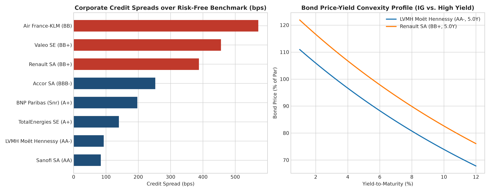

# Corporate Bond & Credit Spread Analytics Engine

A quantitative Fixed Income analytics tool written in Python to price corporate bonds, solve for Yield-to-Maturity (YTM), measure interest rate sensitivities, and benchmark **Investment Grade (IG)** vs. **High Yield (HY)** credit spreads across European corporate issuers.

## Key Features
- **Numerical YTM Solver:** Implements the **Newton-Raphson** root-finding algorithm to extract Yield-to-Maturity from clean market prices.
- **Interest Rate Risk Metrics:** Computes **Macaulay Duration**, **Modified Duration**, **Convexity**, and **DV01** (Dollar Value of a Basis Point).
- **Credit Spread Benchmarking:** Isolates issuer credit spreads (in bps) over risk-free sovereign benchmarks across ratings (`AA` to `BB`).
- **Automated Reporting & Visualization:** Exports a structured CSV risk report and generates a comparative spread & convexity dashboard.

## Mathematical Framework
- **Bond Pricing:** $P = \sum_{t=1}^{N} \frac{C/f}{(1 + y/f)^t} + \frac{F}{(1 + y/f)^N}$
- **Modified Duration:** $D_{\text{mod}} = \frac{D_{\text{mac}}}{1 + y/f}$
- **Credit Spread:** $S_{\text{credit}} = (y_{\text{corp}} - y_{\text{benchmark}}) \times 10{,}000 \text{ bps}$

## Output Preview


## Quickstart
```bash
pip install -r requirements.txt
python bond_analytics.py